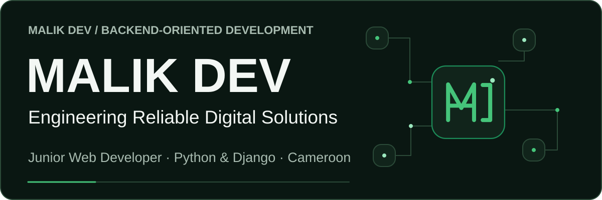
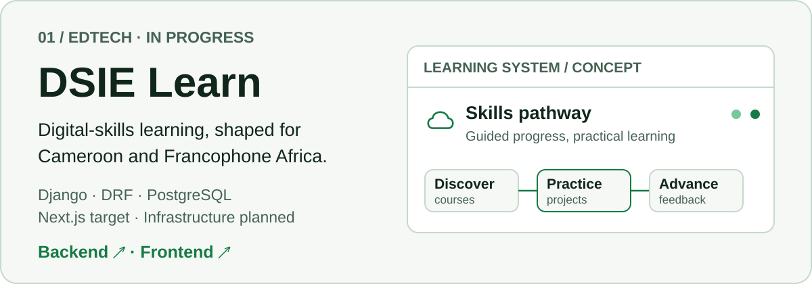
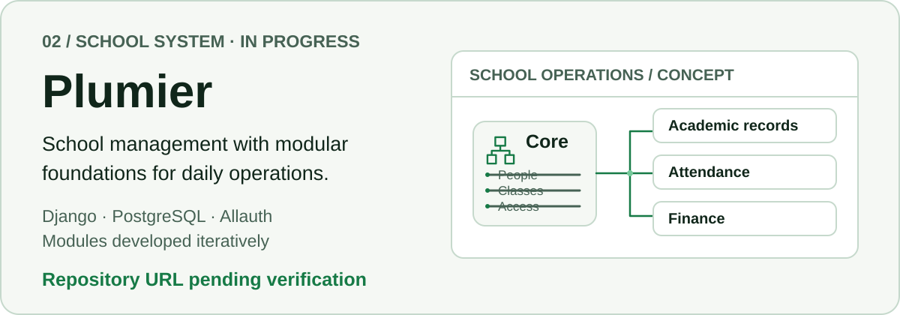
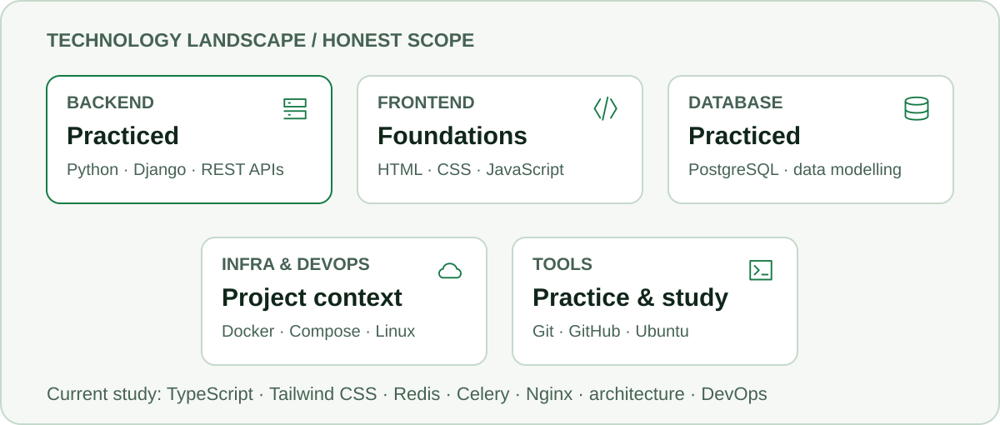
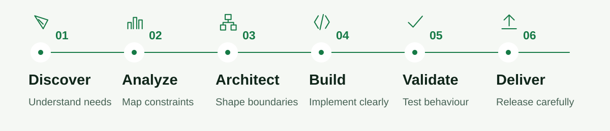
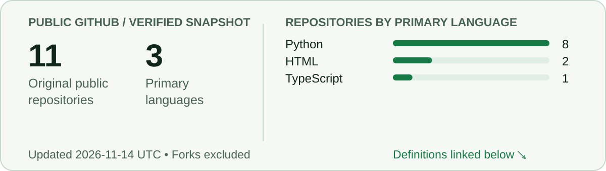

<picture>
  <source media="(max-width: 760px)" srcset="assets/branding/banner-mobile.svg">
  
</picture>

## About Me

I'm **Tiayon Malik**, a junior web developer based in Cameroon. I focus on backend-oriented development with Python and Django. I am growing toward software architecture, reliable infrastructure and DevOps practices. My goal is to build professional solutions that are useful, maintainable and ready to evolve.

## Featured Projects

<picture>
  <source media="(max-width: 760px) and (prefers-color-scheme: dark)" srcset="assets/projects/dsie-learn-mobile-dark.svg">
  <source media="(max-width: 760px)" srcset="assets/projects/dsie-learn-mobile-light.svg">
  <source media="(prefers-color-scheme: dark)" srcset="assets/projects/dsie-learn-dark.svg">
  
</picture>

**DSIE Learn** — A professional digital-skills learning platform being shaped for Cameroon, with an ambition to serve Francophone Africa. Its Django backend is in progress; Next.js, React, TypeScript, Tailwind CSS, Docker Compose and cloud services are architectural targets, not deployment claims. The known repository names are intentionally not linked until their public URLs are verified.

<picture>
  <source media="(max-width: 760px) and (prefers-color-scheme: dark)" srcset="assets/projects/plumier-mobile-dark.svg">
  <source media="(max-width: 760px)" srcset="assets/projects/plumier-mobile-light.svg">
  <source media="(prefers-color-scheme: dark)" srcset="assets/projects/plumier-dark.svg">
  
</picture>

**Plumier** — A modular school and academic management system for a primary school in Cameroon. It is being developed with Python, Django, PostgreSQL and Django Allauth; planned modules are not described here as completed. Its repository link will be added after public verification.

These are original concept illustrations, not product screenshots. Project status is described conservatively.

## Engineering Stack

<picture>
  <source media="(max-width: 760px) and (prefers-color-scheme: dark)" srcset="assets/branding/stack-mobile-dark.svg">
  <source media="(max-width: 760px)" srcset="assets/branding/stack-mobile-light.svg">
  <source media="(prefers-color-scheme: dark)" srcset="assets/branding/stack-dark.svg">
  
</picture>

Python and Django are my main area of practice. The map distinguishes direct practice, project-context use, active learning and areas of deeper study; it does not rank technologies or claim equal proficiency.

## Engineering Approach

<picture>
  <source media="(max-width: 760px) and (prefers-color-scheme: dark)" srcset="assets/branding/approach-mobile-dark.svg">
  <source media="(max-width: 760px)" srcset="assets/branding/approach-mobile-light.svg">
  <source media="(prefers-color-scheme: dark)" srcset="assets/branding/approach-dark.svg">
  
</picture>

## GitHub Activity

<a href="assets/generated/activity.md">
  <picture>
    <source media="(max-width: 760px) and (prefers-color-scheme: dark)" srcset="assets/generated/activity-mobile-dark.svg">
    <source media="(max-width: 760px)" srcset="assets/generated/activity-mobile-light.svg">
    <source media="(prefers-color-scheme: dark)" srcset="assets/generated/activity-dark.svg">
    
  </picture>
</a>

[Snapshot & metric definitions](assets/generated/activity.md) · [GitHub repositories](https://github.com/malikskills?tab=repositories)

<picture>
  <source media="(prefers-color-scheme: dark)" srcset="assets/generated/contributions-dark.svg">
  
</picture>

Daily refresh is configured. Last valid activity images are retained when a refresh fails.

## Connect

**Have a problem worth solving?** 
Let's understand it and build a reliable solution.

[GitHub](https://github.com/malikskills)
